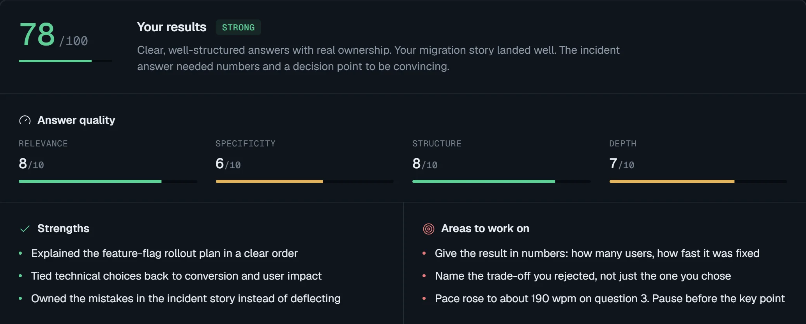

<p align="center">
  
</p>

<h1 align="center">Jobuddy</h1>

<p align="center">
  AI mock interviews tailored to the job you actually want, with scored feedback after every session.
  <br>
  <a href="https://www.jobuddy.ca"><strong>www.jobuddy.ca</strong></a>
</p>

---

Paste a job description and Jobuddy interviews you for that role. It asks
tailored questions in a chat, lets you answer by typing or out loud on camera,
then scores every answer and tells you what to fix. Around the interviews sit
the other parts of a job search: finding roles, writing the resume, tracking
applications, and watching your scores improve.

<p align="center">
  
</p>

## Features

- **Mock interviews.** Paste a job description, pick 2 to 6 questions and a
  focus (mixed, behavioral, technical or system design), and optionally add
  your resume. Each question is timed. You finish with an overall score, a
  rubric (relevance, specificity, structure, depth), and feedback on every
  answer.
- **Speak mode.** Answer out loud on camera. The browser measures your speaking
  pace, hesitation pauses and how much of the time you faced the camera, and
  the feedback covers delivery as well as content. Nothing is recorded: only
  those few numbers go to the server with your transcript.
- **Practice again.** Repeat any finished interview with the same settings and
  new questions, in one click.
- **Progress.** Interviews are grouped by role (the model recognises that
  "Frontend Engineer" and "UI Engineer" are the same job), with a score trend,
  one chart per rubric dimension, an overall readiness score, and the
  strengths and weaknesses that keep coming up.
- **Job Matches.** Upload a resume and pick a city to get real open roles from
  [Adzuna](https://www.adzuna.com), each scored against your resume with an
  explanation of why it fits and what would make you a stronger candidate.
- **Resume Builder.** Chat on the left, a live ATS-friendly resume on the
  right. You and the AI edit the same document. Export to a text-based PDF,
  an exact-preview PDF, PNG, JPG or plain text.
- **Application Tracker.** A Kanban board (Saved, Applied, Interviewing,
  Accepted / Rejected). Add roles by hand or straight from Job Matches.
- **Plans.** A free tier plus Pro and Ultimate subscriptions through Stripe.
  With no Stripe keys configured, billing is off and nothing is limited.

## Tech stack

| Layer | |
| --- | --- |
| Frontend | React 18, Vite, React Router 7, CSS Modules over a design-token layer, lucide icons |
| Backend | Node.js 20, Express (ESM) |
| AI | [OpenRouter](https://openrouter.ai) chat completions, called only from the server |
| Auth and data | Supabase (email, Google and GitHub sign-in; Postgres with row-level security) |
| Jobs | Adzuna API |
| Payments | Stripe Checkout, Customer Portal and webhooks |
| In the browser | Web Speech API, Web Audio, MediaPipe face landmarks, pdf.js, jsPDF |
| Hosting | Vercel (client), Render (API) |

## Getting started

You need Node.js 20+ and an [OpenRouter API key](https://openrouter.ai/keys).
Sign-in needs a free [Supabase](https://supabase.com) project.

```bash
git clone https://github.com/BiboEng/Job-Assistant-App.git
cd Job-Assistant-App
npm run install:all          # installs root, server and client

cp server/.env.example server/.env
cp client/.env.example client/.env
# fill in the values below, then:

npm run dev                  # API on :3001, app on http://localhost:5173
```

Vite proxies `/api` to the server, so there's no CORS setup in development.

### Environment

**`server/.env`**

| Variable | |
| --- | --- |
| `OPENROUTER_API_KEY` | Required. |
| `OPENROUTER_MODEL` | Optional. A paid model is more reliable than a `:free` one. |
| `SUPABASE_URL` | Lets the server verify sign-ins. Set it for any real deployment. |
| `SUPABASE_SERVICE_ROLE_KEY` | Stores interview history in Supabase. Without it, history goes to a local JSON file. |
| `ADZUNA_APP_ID`, `ADZUNA_APP_KEY` | Needed for Job Matches ([free keys](https://developer.adzuna.com)). |
| `STRIPE_*`, `APP_URL` | Paid plans. See [`BILLING.md`](BILLING.md). |

**`client/.env`**

| Variable | |
| --- | --- |
| `SUPABASE_URL`, `SUPABASE_ANON_KEY` | Required to sign in. The anon key is public by design; never put the service-role key here. |
| `VITE_API_BASE_URL` | Optional. The API origin when you aren't using the dev proxy. |

`server/.env.example` lists every tuning option (rate limits, model budgets,
timeouts).

### Database

Supabase tables are created by the SQL files in
[`supabase/migrations/`](supabase/migrations). Run them in filename order in the
Supabase SQL Editor (see [`supabase/README.md`](supabase/README.md)). Features
whose table is missing switch themselves off rather than erroring.

### Tests

```bash
cd server && npm test
cd client && npm test
```

## Project layout

```
├── client/      React app: screens, components, design tokens
├── server/      Express API: routes, controllers, prompts, services
├── supabase/    SQL migrations (applied by hand)
├── n8n/         optional workflow for a follow-up rating email
├── BILLING.md   Stripe, legal and go-live checklist
└── render.yaml  Render blueprint for the API
```

[`CLAUDE.md`](CLAUDE.md) is the detailed engineering reference: architecture,
routing, the design system, the security model and the reasoning behind
specific decisions.

## Security and privacy

- Every API request carries the user's Supabase token, which the server
  verifies, so history is tied to the account.
- Model calls happen only on the server, behind per-IP rate limits, per-user
  daily quotas and a global daily budget.
- The camera never leaves the browser in Speak mode. There is no recording or
  upload path; only the delivery numbers are sent. Spoken answers are
  transcribed by the browser's speech service.
- Resume PDFs are read in the browser. The server only receives the extracted
  text.

Deploying it yourself? Read the "Security model" section of
[`CLAUDE.md`](CLAUDE.md) first.

## License

[MIT](LICENSE) © BiboEng
